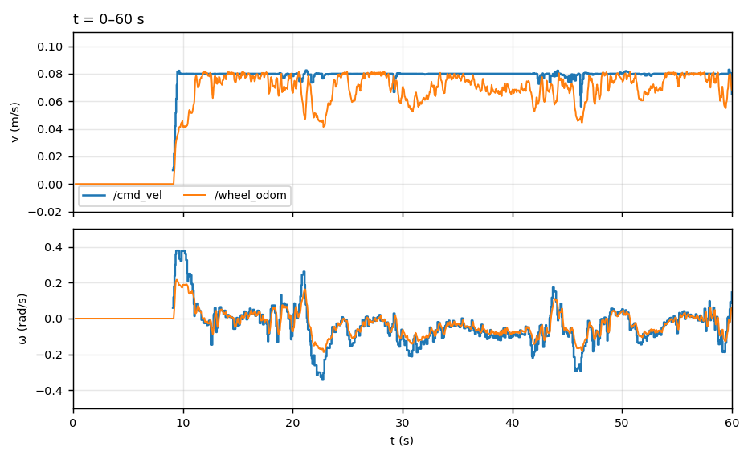

# 펌웨어 · 통신 — STM32F405 + FreeRTOS + micro-ROS

[← 첫 페이지](../../README.md)

 Nav2 속도 지령(<code>/cmd_vel</code>)과 휠 엔코더로 잰 속도(<code>/wheel_odom</code>) — 실주행 첫 60 초(위 병진 v, 아래 회전 ω)

## 하는 일
- 보드가 micro-ROS 로 직접 ROS 2 노드가 된다. `/cmd_vel` 을 받고 `/wheel_odom` · `/rover/status` · `/battery` 를 낸다. Jetson 쪽은 micro_ros_agent(Docker)만 띄운다.
- `/cmd_vel` → 좌우 바퀴 속도 → 피드포워드 + 100 Hz 속도 PID → PWM 20 kHz.
- FG 펄스 → 바퀴 속도 · `/wheel_odom`.
- 스톨 감시: 넣은 duty ≥ 0.60 인 바퀴가 600 ms 동안 3 mm 미만 이동 → 1.5 s 정지 뒤 자동 복구, 10 s 안에 3 번이면 래치.
- `/cmd_vel` 이 500 ms 끊기면 모터 정지.
- 보드 ↔ Jetson: UART → CH340 → USB, 460 800 bps.

## 주요 값

| 값 | 지금 | 식 |
|---|---|---|
| 휠 둘레 | 0.12533 m, 542 펄스 / 회전 | 이동 거리 = 펄스 수 × 둘레 / 542 |
| 유효 게이지 | 0.443 m(실측 트랙 간격 0.245 m) | ω = (v_R − v_L) / B_eff |
| 피드포워드 | KV 5.8, DEADZONE 0.34 | duty = DEADZONE + KV · v (+ PID) |
| 최소 바퀴 지령 | 8 mm/s | 이보다 작은 지령은 8 mm/s 로 올림 |
| 최고 속도 | 바퀴 0.085 m/s, 회전 0.384 rad/s | 2 × 0.085 / 0.443 |

## 알려진 한계
- 설계 통신 속도 2 Mbps 에서 `/wheel_odom` 이 사라진다. 460 800 bps 로 우회 중, 원인 미확정. → [micro-ROS 보드율 회귀](../issues/microros-baud-regression.md)
- 펌웨어는 부팅 뒤 agent 와 세션을 한 번만 맺는다. agent 를 다시 띄우면 보드 리셋이 필요하다. → [보드 연결 · 세션](../issues/board-link-microros-session.md)
- 유효 게이지는 바닥에 따라 달라진다(다른 지점에서 평균 0.414).

## 관련 기록
- [모터 PWM 50 Hz → 20 kHz](../issues/motor-pwm-50hz.md) · [데드밴드](../issues/start-deadband.md) · [스톨 래치](../issues/stall-latch.md) · [휠 오도 스케일](../issues/wheel-odom-scale-slip.md) · [보드 IMU 자이로 무반응](../issues/gyro-source-d455f.md)
- 지금 값: [CURRENT_STACK §2.5](../04_navigation/CURRENT_STACK.md) · 단계별 계획 · 검증: [FIRMWARE_DEV_PLAN.md](../01_firmware/FIRMWARE_DEV_PLAN.md)
