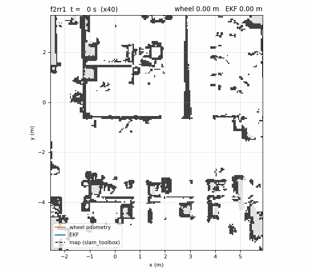

# 센서 융합 — robot_localization EKF

[← 첫 페이지](../../README.md)

 같은 주행을 휠 엔코더만 · EKF · 지도 위 위치(slam_toolbox)로 그림. 휠과 EKF 는 출발 자세만 맞추고 그 뒤 보정 없음. 오른쪽 위 수치 = 그 순간 지도 위치와의 거리, 40 배속

## 하는 일
- 세 입력을 EKF 하나로 합쳐 `odom` 자세를 낸다.

| 입력 | 출처 | 쓰는 값 |
|---|---|---|
| 휠 속도 | 보드 `/wheel_odom` | 병진 · 회전 속도 |
| 자이로 | RealSense D455f 내장 IMU | yaw 속도 |
| 영상 오도메트리 | Isaac ROS cuVSLAM(IR 영상, 프로젝터 끔) | 병진 속도 vx · vy 만 |

- 궤도는 제자리 회전 때 옆으로 밀린다(180° 당 10 ~ 27 cm). 휠과 자이로로는 이 옆 이동을 못 보므로 cuVSLAM 병진 속도로 잡는다.
- 결과(8 목표 순회 f2rr1 기록 444 s): 지도 위 위치와의 최대 차이 휠만 4.81 m, EKF 0.36 m.
- 보드 IMU(ICM-20948)는 자이로가 회전에 반응하지 않아 쓰지 않는다. 카메라 IMU 의 바이어스 · 공분산은 Jetson `sensor_conditioner` 가 맡는다.

## 알려진 한계
- 오래 세워 두면 `odom` 방향이 천천히 돈다(분당 0.04 ~ 0.39°). 원인 미확정, 출발 전 prep 으로 다시 띄운다. → [정지 중 방향 드리프트](../issues/stationary-yaw-drift.md)

## 관련 기록
- [제자리 회전 옆 밀림](../issues/f0-rotation-side-slip.md) · [cuVSLAM 병진 속도 융합](../issues/cuvslam-velocity-fusion.md) · [rf2o(라이다 스캔 정합) 게이트 · 사람 시험](../issues/rf2o-gates-people.md) · [자이로 소스](../issues/gyro-source-d455f.md)
- 지금 값(EKF 입력 · 카메라 설정): [CURRENT_STACK §1](../04_navigation/CURRENT_STACK.md)
