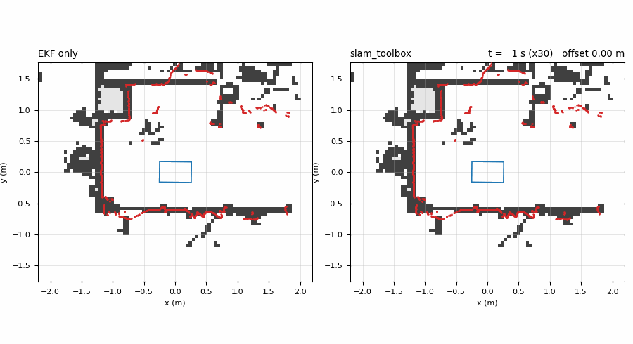

# 위치 추정 — slam_toolbox 저장 지도 위 위치 추정

[← 첫 페이지](../../README.md)

 같은 라이다 스캔(빨강)을 저장 지도에 얹음: 왼쪽 EKF 만 — 점점 벽에서 틀어짐, 오른쪽 slam_toolbox 보정 — 벽에 겹침. 30배속

## 하는 일
- 사무실을 한 번 매핑해 저장한 지도(`office_v3`) 위에서, 라이다 스캔을 지도에 맞춰 `map → odom` 보정을 계속 낸다. EKF 에 남은 오차(순회 중 최대 0.36 m)를 이 보정이 지운다.
- 출발 테이프 = 지도 원점. 매 주행 전 위치 추정이 출발 자세를 맞게 잡았는지 검사한다(어긋나면 주행하지 않음).

## 왜 이렇게 했나
- **원본 slam_toolbox 는 제자리 회전 중 스캔을 버린다** — 새 스캔을 쓸지를 이동 거리로만 정해서다. 궤도 차량은 회전 중에 실제로 밀리므로, 회전 각도도 보도록 고친 포크를 쓴다 → [slam_toolbox 포크](../issues/slam-fork-rotation.md)
- 순회 중 위치가 한 번에 1.33 m 튀었다. 같은 bag 재생으로 재현한 뒤, 원인을 **저장 지도의 빈 곳**으로 확정하고 구멍을 메운 지도(`office_v3`)로 해결. 탐색 창을 줄이는 대안도 효과가 있었지만 큰 오차 회복력을 남기려고 기각 → [위치 점프](../issues/f2-patrol-loc-jump.md)

## 남은 것
- 위치 추정 중 보정 시각이 멈추는 경우가 있어 Nav2 쪽 변환 대기 시간으로 막아 둠(원인 일부만 확인) → [SLAM stamp 정체](../issues/slam-stamp-freeze.md)
- 로버가 서 있으면 스캔을 처리하지 않아 정지 중 방향 드리프트를 고치지 못함 → [정지 중 방향 드리프트](../issues/stationary-yaw-drift.md)

## 더 보기
- 지금 값(지도 · 처리 문턱 · 변환 대기): [CURRENT_STACK §2.1](../04_navigation/CURRENT_STACK.md)
- 사무실 매핑: [F1 매핑](../issues/f1-office-mapping.md)
