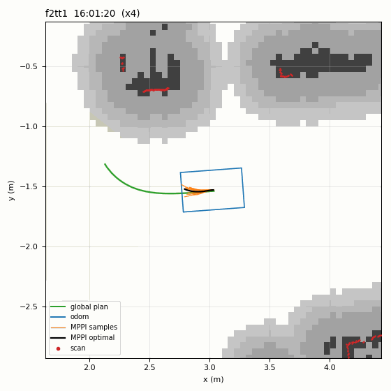
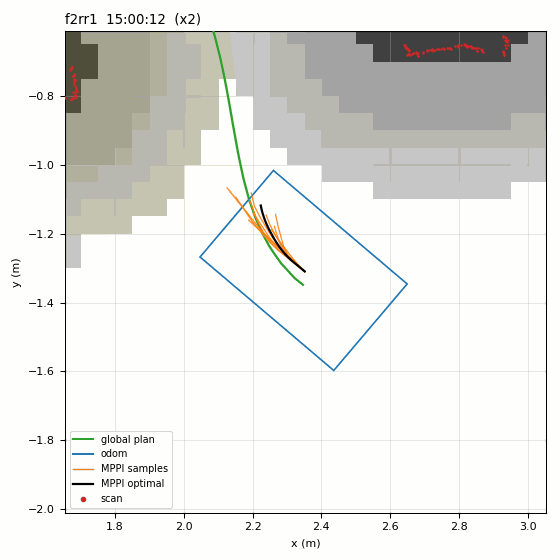

# 자율주행 — Nav2: Smac Hybrid-A* + MPPI

[← 첫 페이지](../../README.md)

  
  

왼쪽: 8 목표 순회 한 번(f2rr1, 40배속) · 오른쪽: 복귀 중 출발점 앞 낮은 상자를 다시 봄 → <code>PathBlockedAhead</code> → <code>MonotoneEscape</code> → 재계획(f2tt1, 4배속, 오른쪽 위 = Nav2 사건)

## 하는 일
- 전역 계획 = Smac Hybrid-A*(실패하면 NavFn), 경로 추종 = MPPI. 재계획은 목표마다 한 번과, 경로가 막혔을 때만.
- 직접 작성한 플러그인(C++):
  - `PathBlockedAhead` — 계획 뒤 **새로 생긴** 장애물이 경로를 막을 때만 재계획(BT 조건)
  - `CopyPath` — 경로를 끝 방향까지 그대로 넘김(BT 노드)
  - `MonotoneEscape` — 장애물과의 거리가 줄지 않는 움직임만 골라 빠져나옴(복구 동작)
- Jetson 에서 도는 최후 방어선 `nav_guard`(PC · Wi-Fi 가 끊겨도 동작) — 목표 시간 · 무진행 한도를 넘으면 취소.
- 결과: 사무실 8 목표 순회를 같은 구성으로 **연속 3 회 8/8, 접촉 0**(f2tt1 · f2tt2 · f2rr1, 412~434 s). 개선 전 기준선(10-14~15, no5 · 3 목표 코스)은 6 회 중 3 회 합격.

## 왜 이렇게 했나
- **계획기**: NavFn 경로가 낮은 상자 옆에 붙어 지나갔다. 오프라인으로 비용 완만화 · 패딩 · Smac 두 종류를 쟀을 때는 모두 기준(+5 cm) 미달이었고, 가장 나은 Smac Hybrid 를 실주행으로 확인해 채택 → [Smac Hybrid 채택](../issues/smac-hybrid-adoption.md)
- **막힘 판정**: 재계획을 줄였더니 새 경로마다 '막힘' 이 나 멈췄다 — 문턱을 올리면 쓸모 있던 상자 막힘도 꺼지므로, 값이 아니라 '경로를 받은 뒤 새로 생겼나' 로 가름 → [only_new](../issues/pathblocked-only-new.md)
- **CopyPath**: 목표에 도착하고도 45 s 를 서 있었다 — BT 가 경로 끝 방향을 0° 로 바꿔 넘긴 결함 → [끝 방향 0°](../issues/bt-copypath-end-yaw.md)
- **MonotoneEscape**: 실제로는 8~11 cm 비어 있는데 '후보 전부 충돌' 로 상자 옆에 섰다. 여러 대책을 시험한 끝에 채택 → [상자 옆 정지 대책](../issues/box-side-stall-remedies.md)
- **MPPI**: 굽은 곳 안쪽을 깎아 상자에 붙었다 — 오프라인 모의 · 실주행 A/B 로 경로 정렬 가중을 조정(안쪽 이탈 10.7 · 15.7 → 4.6 · 1.6 cm) → [굽은 곳 안쪽 깎기](../issues/mppi-corner-cut-pathalign.md)

## 남은 것
- 서쪽 통로 남쪽이 평소보다 좁으면, 계획 · 탈출 · 컨트롤러의 판정 기준이 서로 달라 교착이 난다(11-13, 수정 계획만 있음) → [시험 코스 문서 §7](../04_navigation/TEST_COURSE_AND_GATES.md)

## 더 보기
- 지금 값(계획 · BT · MPPI 크리틱): [CURRENT_STACK §2.3 · §2.4](../04_navigation/CURRENT_STACK.md)
- 시험 코스 · 게이트 · 판정: [TEST_COURSE_AND_GATES.md](../04_navigation/TEST_COURSE_AND_GATES.md) · 기준선 [F2 no5](../issues/f2-baseline-no5.md)
- MPPI 후보 궤적이 어떻게 생겼나:

 MPPI: 주기(10 Hz)마다 후보 궤적(주황)을 굴려 보고 비용 가중 평균으로 하나(검정)를 고름. 기록은 1000 개 중 10 개 표본(f2rr1, 2배속)

