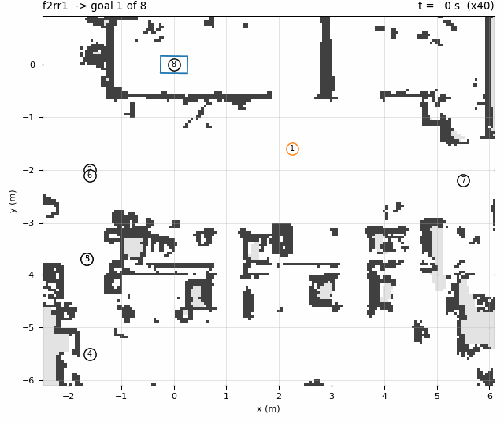
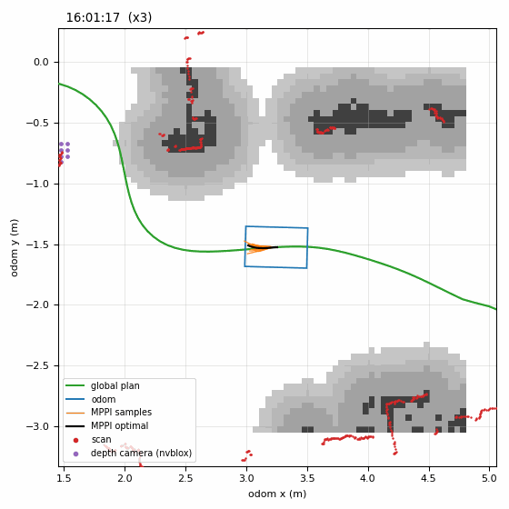

# 자율주행 — Nav2: Smac Hybrid-A* + MPPI

[← 첫 페이지](../../README.md)

  
  

왼쪽: 8 목표 순회 한 번(f2rr1, 40 배속) · 오른쪽: 복귀 길 낮은 상자 — 상자를 지나던 전역 경로(초록) → 깊이 카메라(보라 점)가 상자를 잡자 막힘 판정(<code>PathBlockedAhead</code>) · 탈출 동작(<code>MonotoneEscape</code>) 뒤 경로가 상자를 비켜 감. 주황 = MPPI 후보, 검정 = 고른 궤적. 3 배속

## 하는 일
- 전역 계획 = Smac Hybrid-A*(차체 직사각형으로 충돌 검사). 실패하면 NavFn 으로 대체한다(BT `PlanSmacOrNavFn`).
- 경로 추종 = MPPI(10 Hz, 후보 1000 개). 굽은 곳 안쪽을 깎지 않게 경로 정렬 가중을 높였다.
- 재계획은 목표마다 한 번과, 경로가 막혔을 때만.
- 직접 작성한 플러그인(C++):

| 이름 | 종류 | 하는 일 |
|---|---|---|
| `PathBlockedAhead` | BT 조건 | 경로를 받은 뒤 **새로 생긴** 장애물이 앞 경로를 막으면 재계획 |
| `CopyPath` | BT 노드 | 경로를 점 위치 · 끝 방향까지 그대로 넘김 |
| `MonotoneEscape` | 복구 동작 | 장애물과의 거리가 줄지 않는 움직임만 골라 빠져나옴 |

- `nav_guard`(Jetson 노드): PC · Wi-Fi 가 끊겨도 목표 시간 · 45 s 무진행 한도를 넘으면 모든 목표를 취소하고 정지.
- 결과: 사무실 8 목표 순회를 같은 구성으로 연속 3 회 8/8, 접촉 0(f2tt1 · f2tt2 · f2rr1, 412 ~ 434 s).

## 알려진 한계
- 좁은 통로 안에서 회전해 나와야 할 때 Smac 은 경로를 못 찾는 경우가 있다. 이때는 NavFn 대체 경로로 빠져나온다. 통로 폭이 평소보다 좁아지면(물건이 놓여 로버 중심이 지날 폭 0.20 ~ 0.35 m) 멈출 수 있다. → [Smac Hybrid 채택](../issues/smac-hybrid-adoption.md) · [시험 코스 문서 §7](../04_navigation/TEST_COURSE_AND_GATES.md)

## 관련 기록
- [계획기 선택](../issues/global-planner-choice.md) · [only_new](../issues/pathblocked-only-new.md) · [끝 방향 0°](../issues/bt-copypath-end-yaw.md) · [상자 옆 정지 대책](../issues/box-side-stall-remedies.md) · [굽은 곳 안쪽 깎기](../issues/mppi-corner-cut-pathalign.md) · [nav_guard](../issues/onboard-stop-nav-guard.md)
- 지금 값(계획 · BT · MPPI 크리틱): [CURRENT_STACK §2.3 · §2.4](../04_navigation/CURRENT_STACK.md) · 시험 코스 · 게이트: [TEST_COURSE_AND_GATES.md](../04_navigation/TEST_COURSE_AND_GATES.md) · 기준선 [F2 no5](../issues/f2-baseline-no5.md)

 MPPI: 주기(10 Hz)마다 후보 궤적(주황)을 굴려 보고 비용 가중 평균으로 하나(검정)를 고름. 기록은 1000 개 중 10 개 표본(f2rr1, 2 배속)

