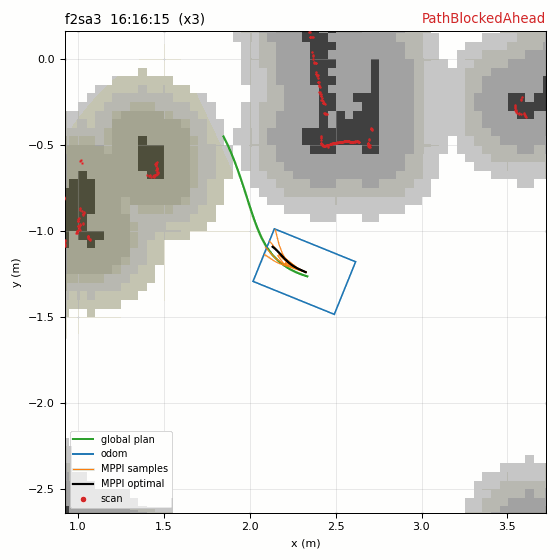

# 장애물 인식 — nvblox(GPU) + 라이다

[← 첫 페이지](../../README.md)

 라이다로는 안 보이는 낮은 상자를 깊이 카메라(옅은 부채꼴 = 시야)로 코스트맵에 올려 옆으로 지나감(f2sa3, 3배속). 회색 = 비용, 진회색 = 치명

## 하는 일
- RealSense 깊이 영상을 Isaac ROS nvblox 로 GPU 에서 3D 재구성하고, 바닥 위 높이 띠를 잘라 로컬 · 전역 코스트맵 층으로 넣는다. 라이다(2D)는 그대로 함께.
- 라이다 높이보다 낮은 물체도 피한다. 출발점 앞에 낮은 상자를 늘 두고 매 순회마다 이것을 시험한다.

## 왜 이렇게 했나
- 처음 구성(STVL 층)으로 기준선을 고정한 뒤 nvblox 로 옮겼다 — 같은 코스 · 같은 지표로 나란히 비교해 채택 → [nvblox 이전 N0~N4](../issues/nvblox-migration-n0-n4.md) · [결과](../05_nvblox/PHASE_N_RESULTS.md)
- 층이 nvblox 원자료보다 x · y 모두 정확히 한 칸(5 cm) 밀려 있었다 — 칸 번호를 반올림으로 구한 결함, 내림으로 고친 포크를 씀 → [round → floor](../issues/nvblox-layer-round-floor.md)
- 전역 코스트맵이 낮은 상자를 잊어 계획 경로가 상자를 지났다 → 전역에도 nvblox 층 → [낮은 상자 기억](../issues/low-box-global-memory.md)
- 카메라 프로젝터를 끈 뒤 맨바닥에 없는 장애물(유령 칸)이 쌓였다 — 출처를 nvblox(카메라 깊이)로 확정하고 깊이 프리셋과 통합 거리를 바꿔 대응 → [유령 칸](../issues/ghost-cells-depth-preset.md)

## 남은 것
- 낮은 물체 옆 여유는 주행마다 몇 cm 씩 다르다(카메라 칸이 매번 6~14 칸으로 들쭉날쭉) → [상자 옆 정지 원인](../issues/box-side-stall-cause.md)

## 더 보기
- 지금 값(층 · 복셀 · 감쇠 · 프리셋 · inflation): [CURRENT_STACK §2.2](../04_navigation/CURRENT_STACK.md)
- 이전 계획: [NVBLOX_MIGRATION_PLAN.md](../05_nvblox/NVBLOX_MIGRATION_PLAN.md)
