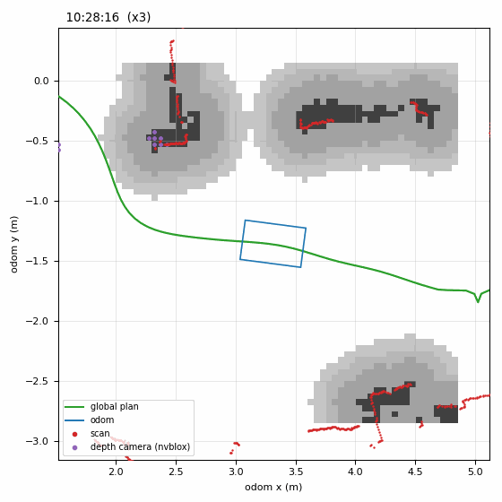

# 장애물 인식 — nvblox(GPU) + 라이다

[← 첫 페이지](../../README.md)

 복귀 길의 낮은 상자: 라이다 점(빨강)은 상자에 하나도 없고, 깊이 카메라가 만든 nvblox 지도(보라 점 — 지금 카메라 시야 안 것만)에만 잡힘 → 상자를 지나던 전역 경로(초록)가 상자 위쪽으로 바뀜. 3 배속. 회색 = 비용, 진회색 = 치명

## 하는 일
- RealSense 깊이 영상을 Isaac ROS nvblox 로 GPU 에서 3D 재구성하고, 바닥 위 높이 띠를 잘라 코스트맵 층으로 넣는다. 로컬(`odom`) · 전역(`map`) 코스트맵 둘 다.
- 라이다(2D) 층도 함께 쓴다. 라이다 높이보다 낮은 물체는 카메라 층으로만 잡힌다.
- 관측이 끊긴 뒤에도 일정 시간 기억해, 지나온 낮은 물체를 돌아올 때까지 피한다.

## 주요 값

| 항목 | 지금 |
|---|---|
| 칸 크기 | 5 cm |
| 표면 뒤 절단 | 2 복셀(0.10 m) |
| 감쇠 | 0.99 — 관측이 끊긴 뒤 약 81 s 유지(벤더 기본 0.95 는 17 s) |
| 통합 거리 | 2.0 m |
| 깊이 프리셋 | High Accuracy, 프로젝터 끔 |
| 층 칸 번호 | `round` → `floor` 로컬 수정(원점이 첫 픽셀 모서리라서, 상류 보고 안 함) |

처음 구성은 STVL 층이었다. 같은 코스 비교에서 코스트맵 상자 여유 nvblox 12.3 · 13.4 · 14.6 cm, STVL 9.3 · 11.7 cm, CPU 는 같은 수준이었다.

## 알려진 한계
- 낮은 물체 옆 여유가 주행마다 몇 cm 씩 다르다(카메라 칸이 매번 6 ~ 14 칸으로 들쭉날쭉). → [상자 옆 정지 원인](../issues/box-side-stall-cause.md)

## 관련 기록
- [nvblox 이전 N0 ~ N4](../issues/nvblox-migration-n0-n4.md) · [결과](../05_nvblox/PHASE_N_RESULTS.md) · [round → floor](../issues/nvblox-layer-round-floor.md) · [낮은 상자 전역 기억](../issues/low-box-global-memory.md) · [유령 칸 · 깊이 프리셋](../issues/ghost-cells-depth-preset.md)
- 지금 값(층 · 복셀 · 감쇠 · 프리셋 · inflation): [CURRENT_STACK §2.2](../04_navigation/CURRENT_STACK.md) · 이전 계획: [NVBLOX_MIGRATION_PLAN.md](../05_nvblox/NVBLOX_MIGRATION_PLAN.md)
