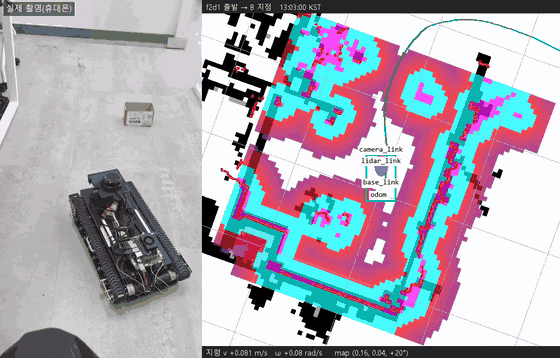

# Indoor Rover

소형 궤도형 로버의 자율주행 소프트웨어 스택(펌웨어 → 센서 융합 → SLAM → 자율주행)을 직접 구축하고 실제 사무실에서 검증하는 개인 프로젝트입니다.
현재: 사무실 8 목표 순회를 같은 구성으로 연속 3 회 완주(8/8, 접촉 0).

  
  

왼쪽: 실제 촬영 · 오른쪽: 같은 시각 ROS 2 bag(로컬 코스트맵·라이다·계획 경로·궤적), 3배속

## 구현한 기능

| 스택 | 내용 | |
|---|---|---|
| 펌웨어 | STM32F405 + FreeRTOS + micro-ROS — 속도 제어, 스톨 보호, `/cmd_vel` 워치독 | [자세히](Docs/stack/firmware.md) |
| 센서 융합 | EKF(휠 + 카메라 IMU + cuVSLAM) — 궤도 미끄러짐으로 틀어지는 방향을 잡음 | [자세히](Docs/stack/fusion.md) |
| 위치 추정 | slam_toolbox(회전 중 스캔 처리 포크) — 저장 지도에 맞춰 남은 오차 보정 | [자세히](Docs/stack/localization.md) |
| 장애물 인식 | nvblox(GPU) 깊이 3D 재구성 + 라이다 — 라이다 아래 낮은 물체까지 | [자세히](Docs/stack/obstacles.md) |
| 자율주행 | Nav2 Smac Hybrid-A* + MPPI, 직접 작성한 BT · 복구 플러그인 | [자세히](Docs/stack/navigation.md) |

 사무실 8 목표 순회 한 번(f2rr1, 40배속)

## 작업 절차

1. **기준 선언** — 시험마다 판정 기준(합격선·예상값)을 주행 전에 적는다. 구성을 바꾸면 그 조합으로 성공한 주행이 나올 때까지 '미검증'으로 둔다
2. **측정** — 출발 전 게이트(휠 오도메트리 수신·지도 위치 갱신·출발 자세 여유)를 통과한 뒤 주행·정지 시험, bag 재생, 합성 데이터(예: 스캔에 사람 몸을 합성)로 확인한다
3. **원인 분리** — 측정과 추정을 구분하고, 추론마다 근거(bag·원문 출력·스크립트 위치)를 붙이며, 기각한 가설과 대안을 남긴다
4. **기록** — `Docs/debug_log/<날짜>/` 에 SUMMARY(시간순)·실행 스크립트·원문 출력. 정정은 지우지 않고 새 항목으로 남기고, 여러 날에 걸친 문제는 `Docs/issues/` 카드로 다시 묶는다

## 문서

- [`PROJECT_OVERVIEW.md`](PROJECT_OVERVIEW.md) — 하드웨어·아키텍처·설계 결정
- [`Docs/04_navigation/CURRENT_STACK.md`](Docs/04_navigation/CURRENT_STACK.md) — 지금 구성의 값과 근거
- [`Docs/04_navigation/TEST_COURSE_AND_GATES.md`](Docs/04_navigation/TEST_COURSE_AND_GATES.md) — 시험 코스·게이트·주행 절차
- [`Docs/issues/ISSUES.md`](Docs/issues/ISSUES.md) — 문제 대장(문제별 증상 → 가설 → 판별 → 조치)
- [`Docs/INDEX.md`](Docs/INDEX.md) — 단계별 계획·결과 문서 색인
- [`Docs/debug_log/`](Docs/debug_log/) — 실험 기록(작업 규약 = [`README.md`](Docs/debug_log/README.md))
