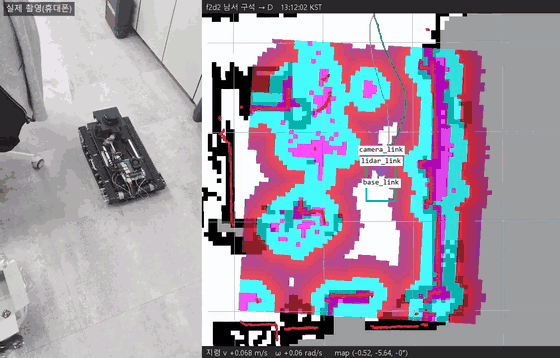
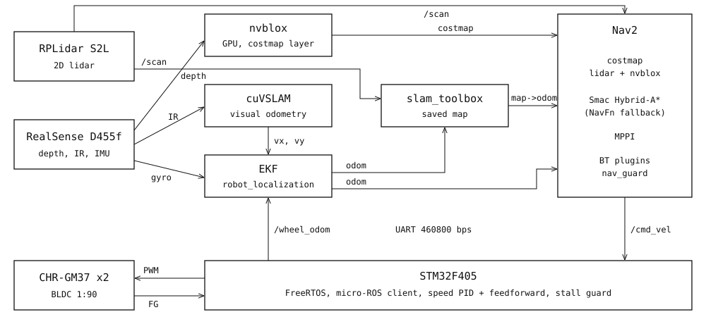
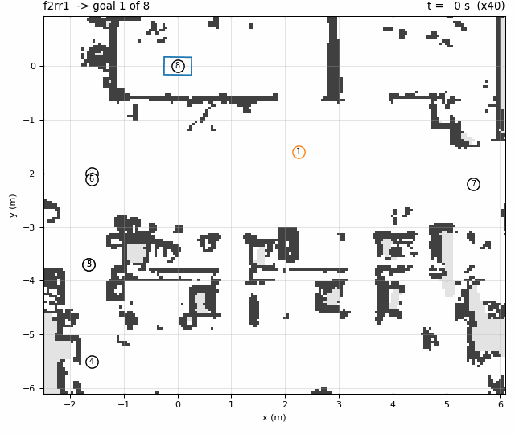

# Indoor Rover

궤도 로버의 실내 자율주행 스택이다. STM32F405 펌웨어(micro-ROS)부터 Jetson 위의 위치추정 · 장애물 인식 · Nav2 주행까지 ROS 2 Humble 로 묶었다.
사람이 다니는 사무실에서 실물로 시험한다 — 같은 구성으로 8 목표 순회 연속 3 회 완주(8/8, 접촉 0).

<p align="center">
  
  
</p>
<p align="center"><sub>왼쪽: 실제 촬영 · 오른쪽: 같은 시각 ROS 2 bag(로컬 코스트맵 · 라이다 · 계획 경로 · 궤적), 3 배속</sub></p>

## 구성

<p align="center"></p>

## 하드웨어

| 부분 | 부품 | 비고 |
|---|---|---|
| 차체 | WT-600 강철 궤도 섀시(스키드스티어) | 500 × 330 × 115 mm, 트랙 게이지 0.245 m |
| 구동 | CHR-GM37-BLDC3650 1:90 × 2(드라이버 내장) | FG 펄스 542 / 휠 1 회전, PWM 20 kHz |
| 제어 보드 | STM32F405RGT6 | FreeRTOS + micro-ROS |
| 연산 | Jetson Orin Nano Super | Ubuntu 22.04 · JetPack 6 · ROS 2 Humble |
| 라이다 | RPLidar S2L(2D) | |
| 깊이 카메라 | RealSense D455f | 깊이 · IR 영상 · 내장 IMU |
| 통신 | UART → CH340 → USB | 460 800 bps |

위치추정 · 제어에 쓰는 센서는 라이다 · 깊이 카메라 · 휠 엔코더 셋이다. 보드 IMU(ICM-20948)는 자이로가 회전에 반응하지 않아 쓰지 않는다.

## 소프트웨어 스택

| 층 | 쓰는 것 | 하는 일 | |
|---|---|---|---|
| 펌웨어 | FreeRTOS · micro-ROS client | `/cmd_vel` → 바퀴 속도(PID + 피드포워드) → PWM, FG 펄스 → `/wheel_odom`, 스톨 감시 · `/cmd_vel` 500 ms 끊김 정지 | [자세히](Docs/stack/firmware.md) |
| 통신 | micro_ros_agent(Docker) · Fast DDS | 보드 ↔ Jetson UART 460 800 bps, Jetson 안 DDS(UDP · 카메라 ↔ cuVSLAM 은 공유 메모리) | [자세히](Docs/stack/firmware.md) |
| 센서 융합 | robot_localization EKF · Isaac ROS cuVSLAM | 휠 속도 + D455f 자이로 + cuVSLAM 병진 속도 → `odom` | [자세히](Docs/stack/fusion.md) |
| 위치 추정 | slam_toolbox(포크) | 저장 지도 `office_v3` 위에서 `map → odom` 보정. 제자리 회전 중 스캔도 처리하도록 조건 한 줄 수정 | [자세히](Docs/stack/localization.md) |
| 장애물 인식 | Isaac ROS nvblox(GPU) · 라이다 | 깊이 영상 3D 재구성 → 로컬 · 전역 코스트맵 층. 라이다보다 낮은 물체까지 | [자세히](Docs/stack/obstacles.md) |
| 계획 · 제어 | Nav2: Smac Hybrid-A*(실패 시 NavFn) · MPPI | 목표마다 한 번 계획, 경로가 막혔을 때만 재계획 | [자세히](Docs/stack/navigation.md) |
| 직접 작성(C++) | BT 조건 `PathBlockedAhead` · BT 노드 `CopyPath` · 복구 동작 `MonotoneEscape` | 새로 생긴 막힘만 재계획 · 경로 끝 방향 유지 · 장애물과의 거리가 줄지 않는 쪽으로 탈출 | [자세히](Docs/stack/navigation.md) |
| 안전(Jetson) | `nav_guard` | PC · Wi-Fi 가 끊겨도 목표 시간 · 45 s 무진행 한도를 넘으면 모든 목표 취소 · 정지 | [자세히](Docs/stack/navigation.md) |
| 운용 도구 | `prep_patrol.sh` · `chk_prep.py` · 러너 | 스택 기동 · 상태 확인(수명 주기 · TF · 파라미터 · 출발 위치) · 목표 순회 · bag 기록 | [도구 목록](Docs/tools/README.md) |

<p align="center"><br/><sub>사무실 8 목표 순회 한 번(f2rr1, 40 배속)</sub></p>

## 저장소 구조

```
firmware/rover_jupiter_fw/   STM32F405 CubeMX 프로젝트 — 우리 코드는 App/(app · hal · drivers · microros)
ros2_ws/src/
  rover_description/         URDF
  rover_bringup/             센서 · EKF · SLAM · cuVSLAM · micro-ROS agent launch
  rover_navigation/          Nav2 설정 · nvblox launch · BT · 복구 플러그인(src/)
Docs/
  stack/                     층별 설명
  04_navigation/             지금 구성(CURRENT_STACK) · 시험 코스 · 게이트
  issues/                    문제 대장(문제별 증상 → 가설 → 판별 → 조치)
  debug_log/<날짜>/          실험 기록(SUMMARY · 스크립트 · 원문 출력)
  tools/                     상시 도구
```

## 문서

- [`Docs/04_navigation/CURRENT_STACK.md`](Docs/04_navigation/CURRENT_STACK.md) — 지금 구성의 값 · 그 값을 정하는 파일 · 근거
- [`Docs/04_navigation/TEST_COURSE_AND_GATES.md`](Docs/04_navigation/TEST_COURSE_AND_GATES.md) — 시험 코스 · 출발 게이트 · 주행 절차
- [`Docs/issues/ISSUES.md`](Docs/issues/ISSUES.md) — 문제 대장
- [`Docs/INDEX.md`](Docs/INDEX.md) — 단계별 계획 · 결과 문서 색인
- [`Docs/debug_log/`](Docs/debug_log/) — 실험 기록(작업 규약 = [`README.md`](Docs/debug_log/README.md))
- [`PROJECT_OVERVIEW.md`](PROJECT_OVERVIEW.md) — 하드웨어 · 설계 결정(옛 계획 포함)
